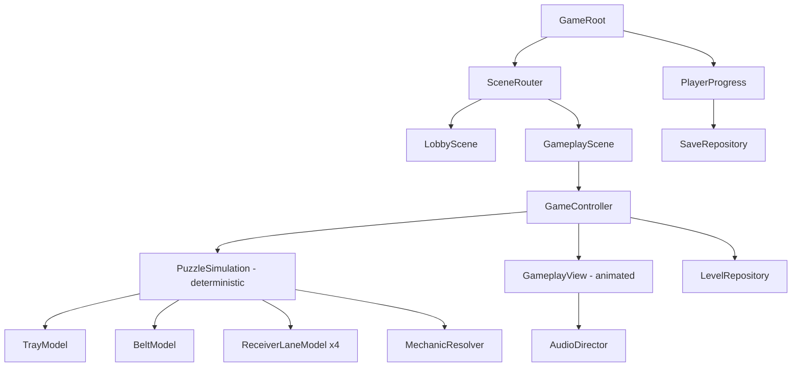
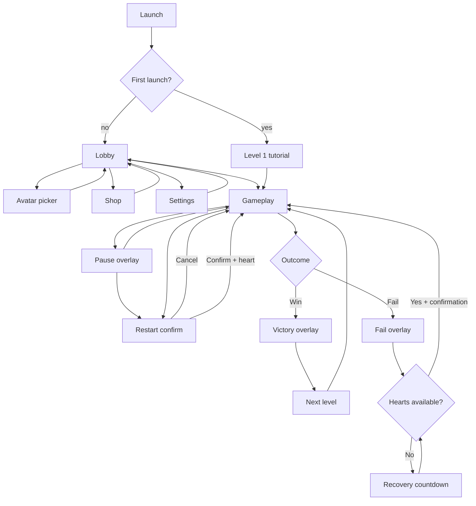

# CHROMALOOP — Complete Godot 4 Game Design & Development Specification

> **Working game name:** **ChromaLoop: Color Conveyor**  
> **Project slug:** `chromaloop`  
> **Document version:** 1.2 • 17 November 2026  
> **Platforms:** Android first, iOS next • **Orientation:** Portrait • **Engine:** Godot 4.x • **Language:** GDScript  
> **Genre:** Single-player, offline-first marble color-sorting puzzle  
> **Production status:** Design specification; not a statement that any features have been implemented.
> **Asset update:** Original 84-sprite ZIP + 32-image UI bundle + 12 precision-cut avatar ZIP now documented in §§19–25. See §18 for locked game rules.

## 0. Purpose, inspirations, and originality boundaries

Build an original, polished mobile game using the owner's **existing image assets and completed audio library**. The key inspiration is the tap-to-release / rotating-conveyor / matching receiver-box puzzle loop described for *Marble Sort!* by its Google Play listing. The independent walkthrough site describes additional obstacles, boosters and strategies. This document converts that inspiration and the supplied older reverse-engineering specification into an **implementable Godot project**. It does **not** assert that the reference game's source code, exact timings, private level data, or internals are known.

**Reference sources (external):**
- [Marble Sort! — Google Play](https://play.google.com/store/apps/details?id=com.microdose.balljam&hl=id): tap to drop, moving conveyor, three-slot matching boxes, loss on an unresolvable full belt, sound-focused play and offline play.
- [MarbleSort.com — unofficial guide](https://marblesort.com/): example strategies, boosters (Magnet / Randomize / Shooter), conveyor pressure and later-stage mechanics. **Unofficial, not game publisher documentation.**
- User-provided `MARBLE_SORT_SPECIFICATION.md`: initial lobby anatomy, 4 receiver lanes, 9 marbles per tray, ~21–22 conveyor slots, 9 proposed puzzle categories, example JSON and meta systems. **Some counts, rules and values were reverse-engineered assumptions, not independently confirmed by official product documentation.**

**Originality:** Use the unique **ChromaLoop** name, original app icon, original level layouts, original UI composition and texts, properly licensed original images/audio, and independent level configuration. Do not copy the reference game's trademark, store screenshots, level walkthroughs, character art, audio or exact UI art. The existing asset pack must be reviewed for licensing and distinctiveness before release. The name is provisional until trademark/store availability checks.

### Evidence labels used below
- **[OFFICIAL]** Confirmed by the Google Play description.
- **[GUIDE]** Described on the independent, unofficial guide.
- **[PRIOR SPEC]** Supplied original Markdown reverse-engineering document, not necessarily verified.
- **[DESIGN]** Our proposed ChromaLoop rule or implementation decision; editable after playtesting.

---

## 1. Product brief

**One-line pitch:** Release colorful marbles into a flowing loop, fill matching color crates in groups of three, and keep the belt from overflowing.

**Player experience:** 30–120 second tactile, satisfying puzzle sessions with gentle click, roll and pop audio; quick touch controls; increasing order-of-operations challenge; no internet required for core levels.

**Design pillars:**
1. **Readable strategy:** Players can see which boxes are active and whether a release will congest the belt.
2. **Juicy feedback:** Beautiful existing PNG sprites, tweened motion and responsive supplied sound assets.
3. **Deterministic fairness:** Outcomes follow defined rules; every shipped level is verified solvable without boosters.
4. **Fast mobile sessions:** Pause/resume, safe area support, 60 fps target with graceful fallback.
5. **Original progression:** ChromaLoop's own map, rewards and level themes, not a pixel-perfect reproduction of any competitor.

**Launch scope:** 30 handcrafted playable levels, first 4 mechanic families, functional onboarding, saves, mute controls, and offline Android build. **Expansion scope:** 100+ verified levels, all mechanic families, live ops, optional ads/IAP, iOS build.

---

## 2. Reference mechanic vs ChromaLoop implementation

| Mechanic | Reference status | ChromaLoop decision |
|---|---|---|
| Tap a top tray to release colored marbles | [OFFICIAL] | Tap an available `TrayTile` and emit its 9 marbles in a scripted sequence [DESIGN, following PRIOR SPEC count]. |
| Continuous circular conveyor | [OFFICIAL] | Oval track represented by 22 ordered logical slots; visual path uses `Path2D` [DESIGN]. |
| Color-matched receiver with 3 holes | [OFFICIAL] | Each open receiver accepts 3 marbles of its required color; then advances its queue. |
| Belt overflow can cause failure | [OFFICIAL] | Fail only when belt is full **and no legal draining/clearing action can progress**; evaluate after pending animations are resolved. |
| Exactly 4 receiver lanes | [PRIOR SPEC] | Keep four by default, configurable in data. |
| 9 marbles in a tray | [PRIOR SPEC] | Use nine in MVP, configurable for future variants. |
| 21–22 belt positions | [PRIOR SPEC] | Select **22** for MVP; expose `belt_capacity` in the level file. |
| Shooter, Magnet, Shuffle boosters | [GUIDE], [PRIOR SPEC] | Keep the *effects* with original UI names **Sweep**, **Picker**, **Reorder**. |
| Mystery, ice, locks, gates, tunnels etc. | [PRIOR SPEC], some [GUIDE] | Modular mechanic plugins; no claim of identical commercial-game behavior. |
| No Undo, restart costs a life | [PRIOR SPEC] | **No Undo. A manually confirmed Restart (including Retry after failure) consumes exactly 1 life. No Home/Return to Lobby control is available during gameplay or its pause/fail overlays.** |
| Lives, coins, streak, shop, events | [PRIOR SPEC] | Implement as ChromaLoop meta systems after core gameplay is stable. |
| Realistic falling marble physics | [OFFICIAL] marketing description | Use *deterministic gameplay* with gravity-like tween animation; real physics is optional cosmetic polish. |

---

## 3. Screens and navigation

### 3.1 Splash and first launch
- ChromaLoop branded splash; asset preloading; first run sets `current_level = 1` and default volume values.
- First session routes directly to tutorial Level 1. Returning players route to Lobby.
- Never require sign-in for offline play.

### 3.2 Lobby / level map
**Original styling:** Bright airy cobalt-to-cyan gradient, subtle floating particles, curved level trail with distinct ChromaLoop motifs (prisms/loops), not a direct recreation of the reference screenshot. Portrait safe-area layout.

- **Fixed header:** avatar icon, hearts, display name (default `Player`), coins and shop `+`.
- **Scrollable center:** staggered saga nodes showing unlocked/current/completed and difficulties; show current level automatically on opening.
- **Optional side rail:** daily gift, challenges, streak; gray out until feature is implemented (do not create dead controls).
- **Primary CTA:** `PLAY LEVEL N` with an optional booster selection panel.
- **Fixed footer (lobby only):** `Play`, `Shop`, `Settings`. A Home button never appears in the gameplay HUD or gameplay overlays.
- **Win streak:** five-step tracker, awarded on five consecutive wins (configurable).

**Acceptance:** opening lobby scrolls to current node; locked nodes cannot start; icons have actual actions; lower-resolution devices do not clip CTA/footer.

### 3.3 Gameplay screen
**Three logical bands:**

```text
┌──────────────────────────────────────────────────┐
│ [Pause]     LEVEL 12        MOVES 14   [Restart] │
├──────────────────────────────────────────────────┤
│ TOP TRAYS / OBSTACLES                            │
│ [3×3] [3×3] [?] [3×3]                           │
│ [3×3] [ICE] [3×3] [LOCK]                        │
│                  ↓ funnel                       │
├──────────────────────────────────────────────────┤
│            OVAL MOVING CONVEYOR                  │
│       ● ● ● ● ● ● ● ● ● ● ● ● ●                 │
│        [center island and track]                 │
│       ● ● ● ● ● ● ● ● ●                          │
├──────────────────────────────────────────────────┤
│ LANE 1       LANE 2       LANE 3       LANE 4   │
│ [○○○]        [○○○]        [○○○]        [○○○]      │
│ [next]       [next]       [next]       [next]   │
├──────────────────────────────────────────────────┤
│ [Sweep]           [Picker]           [Reorder]  │
└──────────────────────────────────────────────────┘
```

- HUD: level, remaining moves **only when enabled by level rules**, pause/restart. **Never show Home, Back to Lobby or Quit Level.**
- Trays: one-tap, clearly indicate blocked/locked tiles.
- Conveyor: fixed logical slots, moving-looking visual track.
- Receivers: 4 front boxes plus queued boxes below each, update after matching 3 marbles.
- Bottom: three booster icons, amounts and tap confirmations.
- Overlay: pause, win, fail, settings, optional revive. Pause provides **Resume**, sound/settings, and **Restart** (costs 1 life), but no exit-to-lobby control. The in-game top Restart button opens a cost confirmation before spending a heart.

### 3.4 Other screens
- **Win:** score/stars, earned coins, next level button, satisfying animation and sound.
- **Fail:** show reason (`Belt jammed` / `No moves left`) and **Retry (−1 life)**, with optional booster rescue later. **No Home/Lobby button.** If 0 lives, show the life-regeneration countdown and wait/restore options; allow OS-level closing/backgrounding without charging a life. Once a life is available, Retry works.
- **Shop:** booster purchases using earned coins; optional IAP after integrations are ready.
- **Settings:** separate music/SFX sliders, haptics toggle, language, reset-data confirmation, credits/privacy links.
- **Daily reward and profile:** later milestone, not essential for first build.

---

## 4. Exact gameplay rules (ChromaLoop v1)

### 4.1 State and turn lifecycle
A state transition is **atomic at the logic layer** even while graphics are animated. On tap:
1. Reject if not active game, animating a locked critical sequence, no moves, tapped tray not accessible, or its release cannot start under the chosen safety rules.
2. Mark tray consumed, decrement move count *if this level uses a move limit*.
3. Create 9 marble tokens with defined colors and deterministic release ordering.
4. For each token, seek an eligible **active** receiver box with room; if eligible, schedule it for absorption; otherwise enqueue it in an available belt slot.
5. After each receiver fills 3, clear box and promote next queued receiver; process belt matching again until no legal absorption remains.
6. Complete every pending logical operation; then evaluate victory, failure, or next input.
7. Emit events for visual/audio feedback; save only on committed checkpoints.

**Important implementation detail:** Model marble states as `TRAY`, `IN_FLIGHT`, `BELT`, `RECEIVER`, `CLEARED`. Never allow one marble token to occupy two logical destinations. Belt slots are indexed integers; motion is visualization of the precomputed state.

### 4.2 Matching and capacity
- Default belt capacity = **22** logical marble slots [DESIGN].
- Every receiver has target color and capacity = **3** [OFFICIAL].
- Four lane queues [PRIOR SPEC] expose only their first (front) receiver.
- Matching a marble decreases its storage occupancy; filling a receiver clears it, then reveals the next receiver in that lane.
- On each resolution pass, check all eligible belt marbles in stable traversal order, to guarantee deterministic results.
- In a basic 9-marble single-color tray example, if 2 open boxes of that color have 3 empty holes each, at most 6 can absorb immediately; 3 remain pending/on belt (assuming no additional queue advances). This is an **illustrative calculation**, not a guarantee for every advanced mechanic.
- A marble should never be removed merely because a matching receiver exists somewhere in the *queued* (inactive) portion of a lane.

### 4.3 Win, failure and restart
**Win:** all required tray marbles were released/cleared, all mandatory targets finished, conveyor contains no remaining marbles, and no mandatory unresolved obstacle persists.

**Jam failure:** belt is at capacity after all possible drain/cascade operations and the current state offers no progressing legal action; show a clear explanation rather than failing during transient animation.

**Move failure:** zero available moves AND remaining mandatory work, after all automatic cascades finish (only on levels with move limit).

**Restart (mandatory shipping rule):** A player-initiated Restart of an active level **consumes exactly 1 heart**, then resets that level to its original configuration using its stored seed. It does not spend a heart merely because the confirmation dialog opens or the user cancels. A failure-screen **Retry** is the same paid restart operation: deduct exactly 1 heart and load the level once. Avoid double-charging when a run has already failed. At zero hearts, disable Restart/Retry, display the next-life countdown, and keep the player on the current game/fail screen until the player can retry (or the app is closed). The button must disclose `Restart · −1 Heart` and ask for confirmation. Do not implement free retry in production; test environments may inject a mock wallet to test without draining real progress.

**No in-game return to home:** During an active level, pause and failure overlays must not display Home, Back to Lobby, Exit Level, or an equivalent. Android system Back opens/resumes the Pause overlay rather than navigating to Lobby. iOS app switching and OS app closure remain available. Background/foreground interruptions must not deduct a heart and must restore the ongoing run from a safe checkpoint. **After a victory**, `Next Level` may advance directly into gameplay, while a separate `Continue` may return to the lobby if desired; that victory flow is no longer an active run. All new-run life costs, if any, are separate design decisions and are not imposed here.

**Life balance & save transaction:** `MAX_LIVES = 5` by default. Implement `try_spend_life_for_restart()` as one atomic persistent transaction: check available hearts, subtract 1, persist balance/timestamps, then rebuild the level exactly once. Deducting must not be repeated by scene reloads, save restoration, or multiple fast taps. Regeneration interval remains configurable (the prior document suggested 20 minutes per life but this is a design setting, not verified official behavior).

### 4.4 Turn ordering and animation
- Simulation is frame-rate independent.
- Belt visual scroll uses a fixed `Path2D` and `PathFollow2D` or sampled points. Marbles' *slots* remain source of truth.
- Visual release staging: tap bounce → drop to funnel → move to target/belt → receiver fill → box pop → next-box advance → new matches.
- Block conflicting taps while commit is underway, or queue at most one input; never double-spend a move.
- Allow fast-forwarding animations in tests without modifying outcomes.

---

## 5. Obstacles and puzzle families

The prior specification lists nine families. Implement each via a `Mechanic` contract with trigger, rules, serialization and test fixtures. Exact behavior below is **ChromaLoop design**, not claimed equivalence to the reference game.

| Family | Objects | ChromaLoop mechanic | Target phase |
|---|---|---|---|
| 1. Hidden | Mystery crate, covered tray | Reveal a stored color only after a neighboring tray is cleared | MVP |
| 2. Locks | Lock, key, gate | Collect key token or clear named prerequisite to open barrier | MVP |
| 3. Tracks | Tunnel, loop switch | Redirect marbles from one intake to a specified belt exit | Expansion |
| 4. Color gates | Colored panels | Release only after required color tally is met | Expansion |
| 5. Obstacles | Ice, stone, wood, pin | Break, thaw or clear by adjacency / tagged action | MVP |
| 6. Linked | Chain / paired trays | Shared unlock count or coordinated clearing | Expansion |
| 7. Direction | Arrow, swap | Alter destination ordering or exchange two selected entries | Expansion |
| 8. Frozen | Ice tray, frozen receiver | Freezes until specified adjacent/matching clear occurs | MVP |
| 9. Multiply | `×2` gate | Duplicate passing tokens only when destination capacity check succeeds | Expansion |

Advanced additions to evaluate *after* playtesting: elevator-style receiver waves [GUIDE], stone-box and fridge-like containment ideas mentioned in the current store listing; introduce original art/rules instead of tracing another game's stage layouts.

---

## 6. Boosters

| ChromaLoop name | Existing sprite candidate | Effect | Guardrails |
|---|---|---|---|
| **Sweep** | `048_cannon.png` | Clear belt tokens or move them to a well-defined safe sink (choose rule explicitly). MVP design: clear belt and record as rescued, subject to objective rules. | Cannot silently prevent win correctness; count action in telemetry. |
| **Picker** | `049_magnet.png` | Choose one otherwise inaccessible source marble/tray release target. | Clearly preview target; handle empty/blocked states. |
| **Reorder** | `044_shuffle.png` or `050_swap_arrows.png` | Rearrange queued receiver boxes, maintaining stable color totals. | Only reshuffle eligible queues; avoid unsolvable outcomes. |

**Design note:** The old spec described Cannon / Magnet / Shuffle; unofficial guide uses Shooter / Magnet / Randomize. ChromaLoop's names and implementation are independent. Boosters must **not** be required for base-level solvability. Include a confirmation when booster supply is low and never spend one if activation fails.

---

## 7. Existing assets: image and audio integration

### 7.1 Images we know about
The previous sprite sheet was split into **84 individual PNGs** in `mobile_game_assets/`, with an available ZIP. Additional UI and authoritative precise avatar ZIPs are cataloged in §19. Refer to them by logical IDs, not hardwired paths in gameplay.

**Representative mapping:**

| Asset ID | Existing PNG examples | Usage |
|---|---|---|
| Marble colors | `001_ball_red.png` ... `015_ball_brown.png` | Moving marble sprites. Make a `ColorId → Texture2D` mapping. |
| Nine-hole trays | `016_tray_beige.png` ... `021_tray_pink.png` | Top source tiles. |
| Receiver columns | `022_column_red.png` ... `027_column_pink.png` | Three-hole receiver box art, if suitable after layout testing. |
| Conveyor | `028_conveyor_straight.png`, `029_conveyor_rounded.png`, `030_conveyor_curved.png`, `031_conveyor_ring.png` | Conveyor visual pieces; avoid seams by using a custom texture mesh/path if needed. |
| Funnel | `032_funnel.png` | Release chute. |
| Obstacles | `033_mystery_box.png` ... `040_spike.png` | Locked/mystery/crate/ice/chain/pin mechanics. |
| Actions / gates | `041_color_square.png` ... `045_double_score.png` | Gates, arrows, shuffle, multiplier. |
| Portals & boosters | `046_portal_blue.png` ... `050_swap_arrows.png` | Mechanics and booster art. |
| Economy & lobby | `051_gumball_machine.png` ... `063_settings.png` | Store, currency, hearts, gifts, settings. |
| Buttons / map nodes | `064_play.png` ... `073_hard.png` | Play, navigation, level nodes, difficulty. |
| Celebration | `074_star_gold_1.png` ... `084_crown.png` | Stars, bursts, confetti, crown. |

**Important:** Only the source sprite sheet and the earlier exported files have been seen in this conversation. We have **not** audited each individual PNG for edge quality, exact transparency, resolution or legal rights. In the Godot implementation, import the actual files provided; do not substitute guessed file assets.

### 7.2 Audio we know about
The user reports having the **full audio set**, but no individual audio files or filenames have been provided for mapping. Do **not** generate replacement music/SFX, assume a soundtrack name, or invent file paths. Create an inventory when files are supplied.

| Sound event key | Intended sound | Required file status |
|---|---|---|
| `ui_tap` | General UI tap | Existing audio — filename TBD |
| `tray_select` | Tray pressed | Existing audio — filename TBD |
| `marble_release` | Marble drop | Existing audio — filename TBD |
| `marble_roll` | Short movement/rolling loop | Existing audio — filename TBD |
| `receiver_fill` | Marble enters colored box | Existing audio — filename TBD |
| `receiver_complete` | Three-slot box clears | Existing audio — filename TBD |
| `belt_warning` | Conveyor nearly full | Existing audio — filename TBD |
| `booster_use` | Booster activation | Existing audio — filename TBD |
| `victory` / `failure` | Level conclusion | Existing audio — filename TBD |
| `lobby_music` / `gameplay_music` | Looping BGM | Existing audio — filename TBD |

Create `AudioCatalog.gd` and two buses (`Music`, `SFX`) plus `Master`. Limit concurrent rolling sounds to avoid an unpleasant loud mix; pitch variation ±3% optional. Audio must respect OS mute/haptics settings.


### 7.3 Missing visual assets — original checklist (see updated §19 for generated assets)

**Historical P0/P1 inventory (before additional assets were generated):** The 84 exported PNGs cover 15 marble variants, 6 nine-hole tray variants, 6 three-hole receiver columns, conveyor parts, funnel, obstacles, boosters, coin/life/shop icons, buttons, level node prototypes, stars, confetti, and crowns. These PNGs are separate sprites, **not complete finished screen layouts**. A separate menu background may have been designed previously, but it has **not been confirmed inside this asset ZIP**, so treat its import as pending rather than regenerating blindly. Likewise, reported audio is owned by the user but its filenames have not been audited.

| Priority | Needed visual | Suggested specification | Why existing PNG pack is insufficient |
|---|---|---|---|
| P0 | Original ChromaLoop wordmark/logo + app icon | Transparent wordmark PNG; independent 1024×1024 app icon | No bespoke brand identity in 84 sprites |
| P0 | **Gameplay background** | Portrait 1080×1920, no UI/text, clear tray/belt/receiver contrast | Game mechanics need a coherent background surface |
| P0 | **Main lobby/saga background** | Portrait 1080×1920, subtle bubbles/stars, empty central navigation area | Verify previously created background exists before making another |
| P0 | **Scalable HUD and dialog frames** | 9-slice friendly frames/panels with transparent borders | Need pause, restart confirmation, fail, victory, coin/life displays |
| P0 | **Restart + pause + resume controls** | Separate transparent icons, 256×256 baseline | Existing pack has play/settings but no dedicated pause/restart icons |
| P0 | **Large PLAY / RESTART / RETRY buttons** | Wide yellow and contrasting red/purple nine-slice designs; preferably create in Godot | Existing `064_play.png` is a green round icon, not a wide CTA |
| P0 | **Tutorial pointer and callout panel** | Transparent pointing hand plus 9-slice tooltip panel | Required to teach tap → funnel → receiver |
| P1 | **Saga route/path art** | Tileable curved winding path, loop/prism original motif | Current level nodes are present, but connecting route is missing |
| P1 | **Victory / failure title treatment** | Transparent celebration and jam title art, optionally assembled with Godot text | Existing stars/confetti do not supply complete result UI |
| P1 | **Profile/avatar icon** | Original mascot/avatar, 256×256 or larger | The pack has no confirmed player profile icon |
| P1 | **Life regeneration + countdown badges** | Scalable tiny clock/life icon variants | Existing hearts cover life icon but not timer UI |
| P2 | **Store / offer cards and reward event art** | Nine-slice cards plus unique bundle/event illustrations | Existing shop bag, gifts, coins cover icons but not full cards |
| P2 | **Additional color variants** | Individual transparent marble/receiver/tray for *only* colors used in level JSON | Existing pack covers 15 marbles, 6 tray colors, 6 receivers; no reason to mass-generate unused colors |

**Do not generate again unless deficient:** basic colored balls, supplied receiver columns, nine-hole trays, funnel, obstacles, coins, hearts, boosters, existing stars/confetti/crown, or audio. First inspect their import quality and consistency in Godot. Use `Control`, `StyleBoxFlat`, `StyleBoxTexture`, `Label`, `TextureButton`, and procedural curves for most scalable UI instead of generating a unique PNG for every panel state.

**Asset delivery convention:** Each new static decorative image should ship as an individual PNG with transparency when appropriate, named `bg_gameplay.png`, `brand_wordmark.png`, `icon_app.png`, `ui_pause.png`, `ui_restart.png`, `tutorial_hand.png`, etc. Full-screen backgrounds are opaque portrait PNG/WebP; export small assets at sufficient resolution for 2x/3x display scaling. Add each to `asset_manifest.json` and verify licensing, trim/alignment, and safe-area readability.

### 7.4 Import standards
- Keep PNG transparency with alpha; avoid dark halos by checking filtering and import settings.
- Use `CanvasItem` textures, `Sprite2D` and `TextureRect`; maintain consistent rendered marble diameter.
- UI uses Godot anchors and `Control` containers. Provide responsive layout and safe-area padding.
- Avoid re-exporting original artwork repeatedly at lower resolution; generate scaled versions in engine when possible.
- Audio: use OGG Vorbis for long music, WAV for very short latency-critical cues if size allows; preserve source masters outside runtime import folder.
- Keep asset manifest with `logical_key`, `relative_path`, `type`, `status`, `license/ownership`, `notes`.

---

## 8. Godot architecture

### 8.1 High-level architecture



### 8.2 Directory structure

```text
ChromaLoop/
├── project.godot
├── README.md
├── addons/                         # Third-party plugins, only when approved
├── assets/
│   ├── sprites/                    # Import existing PNGs here
│   │   ├── marbles/
│   │   ├── trays/
│   │   ├── receivers/
│   │   ├── conveyor/
│   │   ├── obstacles/
│   │   ├── boosters/
│   │   └── ui/
│   ├── audio/                      # Import existing audio files here
│   │   ├── music/
│   │   └── sfx/
│   └── fonts/
├── data/
│   ├── levels/
│   │   ├── level_001.json
│   │   └── level_002.json
│   ├── asset_manifest.json
│   └── game_balance.json
├── scenes/
│   ├── app/GameRoot.tscn
│   ├── lobby/Lobby.tscn
│   ├── gameplay/Gameplay.tscn
│   ├── gameplay/TrayTile.tscn
│   ├── gameplay/Marble.tscn
│   ├── gameplay/ConveyorBelt.tscn
│   ├── gameplay/ReceiverLane.tscn
│   ├── ui/WinPopup.tscn
│   ├── ui/FailPopup.tscn
│   ├── ui/ShopPopup.tscn
│   └── ui/SettingsPopup.tscn
├── scripts/
│   ├── autoload/SceneRouter.gd
│   ├── autoload/PlayerProgress.gd
│   ├── autoload/AudioDirector.gd
│   ├── core/GameController.gd
│   ├── core/PuzzleSimulation.gd
│   ├── core/MarbleToken.gd
│   ├── core/BeltModel.gd
│   ├── core/ReceiverLaneModel.gd
│   ├── core/TrayModel.gd
│   ├── core/MechanicResolver.gd
│   ├── data/LevelRepository.gd
│   ├── data/LevelValidator.gd
│   ├── meta/LivesService.gd
│   ├── meta/RewardService.gd
│   ├── view/ConveyorView.gd
│   ├── view/MarbleView.gd
│   └── boosters/
│       ├── Sweep.gd
│       ├── Picker.gd
│       └── Reorder.gd
├── tests/
│   ├── test_absorption.gd
│   ├── test_conveyor_overflow.gd
│   ├── test_receiver_queue.gd
│   ├── test_restart_determinism.gd
│   └── test_level_validator.gd
├── export_presets.cfg               # Generate locally; no secrets committed
└── docs/
    ├── GAME_SPECIFICATION.md
    ├── ASSET_INVENTORY.md
    ├── AUDIO_MAPPING.md
    └── LEVEL_AUTHORING.md
```

### 8.3 Scene tree, Gameplay

```text
Gameplay (Control)
├── Background (TextureRect)
├── SafeArea (MarginContainer)
│   └── Layout (VBoxContainer)
│       ├── TopHUD (HBoxContainer)
│       ├── Playfield (Control)
│       │   ├── Trays (Node2D)
│       │   ├── Funnel (Sprite2D)
│       │   ├── Conveyor (Node2D)
│       │   │   ├── Track (Path2D)
│       │   │   └── Marbles (Node2D)
│       │   └── ReceiverLanes (Node2D)
│       └── Boosters (HBoxContainer)
├── OverlayLayer (CanvasLayer)
└── AnimationPlayer
```

### 8.4 Signals and responsibilities
- `GameController`: validate tap, call simulation, persist, trigger end conditions.
- `PuzzleSimulation`: pure data operations; never references Nodes, Tween or audio.
- `BeltModel`: fixed-size indexed array of marble IDs, insert/remove/count.
- `ReceiverLaneModel`: FIFO queue of receiver records, 3-hole current count.
- `MechanicResolver`: ordered effects with explicit precedence.
- `ConveyorView`: smooth sprite positions around bezier/oval path.
- `AudioDirector`: sound event mapping, mixing, settings.
- `PlayerProgress`: settings, level state, earnings, boosters, timestamp-based life regeneration and atomic restart heart charges.
- Signals: `marble_released`, `marble_absorbed`, `receiver_completed`, `belt_warning`, `level_won`, `level_failed`, `state_committed`.

Use `Autoload` sparingly for truly global state (scene navigation, audio, player progress). Keep puzzle logic scoped to its own scene/object to enable tests.

---

## 9. Level schema (JSON)

The schema below is a **ChromaLoop original config format**, inspired by the structure of the user's old MD. All numerical values are configurable per level.

```json
{
  "schema_version": 1,
  "id": "level_001",
  "number": 1,
  "title": "First Loop",
  "difficulty": "easy",
  "mechanic_tags": ["basic_matching"],
  "seed": 1001,
  "belt_capacity": 22,
  "lane_count": 4,
  "tray_marble_count": 9,
  "moves_limit": null,
  "starting_boosters": {"sweep": 0, "picker": 0, "reorder": 0},
  "trays": [
	{"id": "t1", "x": 0, "y": 0, "type": "standard", "marbles": ["red","red","red","red","red","red","red","red","red"]},
	{"id": "t2", "x": 1, "y": 0, "type": "standard", "marbles": ["blue","blue","blue","blue","blue","blue","blue","blue","blue"]}
  ],
  "lanes": [
	[{"id":"r1","color":"red","capacity":3},{"id":"r2","color":"blue","capacity":3}],
	[{"id":"r3","color":"red","capacity":3},{"id":"r4","color":"blue","capacity":3}],
	[{"id":"r5","color":"red","capacity":3}],
	[{"id":"r6","color":"blue","capacity":3}]
  ],
  "obstacles": [],
  "rewards": {"coins": 30, "stars": 3}
}
```

**Color IDs:** use a canonical registry e.g. `red`, `blue`, `green`, `yellow`, `purple`, `orange`, `pink`, `cyan`, `navy`, `lime`, `silver`, `rainbow`, `black`, `diamond`, `brown`. Special marbles (rainbow/diamond) have independent rules and should **not** be treated as standard colors until implemented. Keep IDs independent from filenames. The old MD listed a broader palette, including `light_junk`; add it only when a matching asset and rule are explicitly defined.

**Level invariants:**
- Every declared marble color has a valid sprite mapping.
- Default basic levels have equal total marble supply and receiver demand per color.
- Receiver capacity stays 3 for standard receiver boxes.
- All referenced locks, keys and linked IDs resolve.
- Level seed is stored so replays are identical.
- No required solution demands IAP or ad viewing.
- All levels pass a finite-state solver or clearly documented exhaustive/memoized search limits.

---

## 10. Example GDScript APIs (contracts, not complete game code)

```gdscript
# scripts/core/BeltModel.gd
class_name BeltModel
extends RefCounted

var capacity: int = 22
var slots: Array = []  # null or token ID

func setup(slot_count: int) -> void:
	capacity = slot_count
	slots.resize(capacity)
	slots.fill(null)

func is_full() -> bool:
	for token_id in slots:
		if token_id == null:
			return false
	return true

func count_used() -> int:
	var total := 0
	for token_id in slots:
		if token_id != null:
			total += 1
	return total
```

```gdscript
# scripts/core/PuzzleSimulation.gd -- public interface sketch
class_name PuzzleSimulation
extends RefCounted

signal marble_absorbed(token_id: String, receiver_id: String)
signal receiver_completed(receiver_id: String)
signal simulation_finished(result: String)

func load_level(level_data: Dictionary) -> void:
	pass # validate and initialize all logical models

func can_release(tray_id: String) -> bool:
	return false # replace with access / state validation

func release_tray(tray_id: String) -> Dictionary:
	return {} # atomic state transition and ordered visual event list

func resolve_matches() -> Array:
	return [] # stable sequence of absorption events

func check_result() -> String:
	return "playing" # playing / won / jammed / no_moves
```

The `pass` and stub returns above are **intentional API placeholders**, not functioning gameplay. Build concrete tests before connecting animations. Never ship these stubs as completed features.

---

## 11. UX, animation, and audio timing

| Event | Proposed visual treatment | Proposed duration |
|---|---|---|
| Tap | Tiny scale-down and spring-back | 80–140 ms |
| Marble release | Short stagger to funnel | 40–80 ms per token |
| Marble travel | Ease along configured path | 180–350 ms |
| Enter receiver | Soft shrink/bounce | 90–160 ms |
| Receiver completes | Pop, glow, advance queue | 180–300 ms |
| Belt almost full | Subtle warm pulsing indicator | Until danger clears |
| Level win | Star pop, confetti, victory sound | 600–1200 ms |

These are **tuning starting points**, not verified reference-game measurements. Prefer a steady rhythm rather than visual delays that block next move too long. Allow reduced motion in accessibility settings.

**Haptics:** light click on tray release, soft tick on receiver match, stronger success pulse on victory; obey user setting and platform support.

---

## 12. Original economy and progression

| Feature | MVP | Expansion |
|---|---|---|
| Level progression | Sequential with stars | Level map with themes and chapter gates |
| Earned coins | Award on wins; no spending required | Coin shop / boosters |
| Hearts | Max 5; every confirmed Restart/Retry deducts exactly 1; zero hearts blocks retry | Optional heart refill offers; regeneration interval configurable (prior spec suggested 20 min per heart) |
| Win streak | Can track locally | Five-step streak reward |
| Daily gifts | Not required | Offline-safe daily claim with integrity checks |
| Booster stock | Fixed tutorial allotments | Earned/coin-purchased boosters |
| Ads | None in MVP | Opt-in rewarded ads; bounded interstitial cadence |
| IAP | None in MVP | Remove Ads and coin bundles with platform receipt validation |

**Player fairness:** avoid artificial impossible levels, coercive purchases, or ad-gated essential progress. Google Play reviews include criticism of too many ads and scarce free recovery options; use these as qualitative feedback, not as proof of exact monetization rules.

**Purchases:** Godot needs platform-specific plugins / native integration. Validate plugin compatibility with the selected Godot version, Android export templates, and iOS/Xcode versions before planning release. Do not hard-code SDK keys or store them in source control.

---

## 13. Saving, offline use, and privacy

Save locally under `user://save_v1.json` via `FileAccess` using atomic temp-write and rename strategy. Version every save; persist player progress, level, stars, coin count, booster inventory, settings, and life regeneration timestamps. Do **not** save an in-flight animation state as if it were final.

At startup validate save schema, recover from corrupted saves via backup, and migrate old versions. Offline level completion must work without network. Optional ads, analytics and IAP are gated behind consent and online availability. No account required for baseline play.

---

## 14. Testing plan

### 14.1 Deterministic logic tests
1. Each three-slot box accepts at most 3 matching marbles.
2. Wrong colors cannot fill the front receiver.
3. Finishing a receiver correctly advances its lane queue.
4. Belt count never exceeds its configured capacity.
5. A cascade can absorb formerly stranded tokens when a matching queued receiver becomes active.
6. A full belt with a pending legal cascade is not falsely declared jammed.
7. A level with no remaining trays, targets or belt tokens resolves win.
8. Move-limit failure waits until cascade resolution.
9. Replay of identical level seed and action sequence returns identical state.
10. Booster activation cannot create negative inventory or violate objectives.
11. Save/load preserves progress and user audio settings.
12. Two taps during animation cannot spend the same tray twice.

### 14.2 Level solver / validator
Provide an offline development tool that:
- Validates color supply vs receiver demand, references, dimensions and mechanics.
- Simulates legal tray actions and receiver cascades using the same simulation as the game.
- Explores states with memoization, a timeout/state budget and stable serialization.
- Reports `solvable`, `unsolvable`, or `unverified (search limit)` **without treating unverified as solved**.
- Outputs a winning action trace for testing/tutorial authoring where possible.

### 14.3 Device testing
- Android small and tall portrait screens, 60/90/120 Hz devices, low-memory handset.
- Screen rotation locked intentionally; notch/safe area; background/resume; audio interrupted by call.
- Touch target minimum ~44–48 logical pixels; no accidental overlaps.
- Offline mode, startup with bad save, low storage, audio mute, slow animation setting.
- Profile on representative mid-range Android hardware; target stable 60 fps with reduced effects fallback.

---

## 15. Build order and acceptance criteria

### Milestone A — Foundation
- Godot 4.x project, portrait scaling and safe-area containers.
- Asset catalog integrated with existing 84 PNG exports.
- Audio catalog **placeholder keys only** until audio files are imported.
- Intro tutorial level data and basic menu.

**Done when:** boots into a visible level with matching game sprites; no missing references; works on Android debug build.

### Milestone B — Fully playable vertical slice (Levels 1–10)
- Deterministic core: trays → release → belt → receivers → cascades.
- Real tap input, smooth path animation, win/fail/restart, clear UI.
- Implement matching and congestion with unit tests.

**Done when:** 10 different solvable levels can be finished on-device without booster or networking; no lost/doubled tokens.

### Milestone C — Content and polish (Levels 11–30)
- Mystery, lock, crate/ice mechanics; light tutorial prompts.
- Imported real audio, sound mixing, haptics, pause, stars, save system.
- Level validator and basic in-editor authoring utility.

**Done when:** 30 levels validated, no game-breaking save errors, all audio user-adjustable.

### Milestone D — Full meta systems
- Original saga map, 5-slot streak, coins, mandatory five-heart lives with paid Restart/Retry, shop and boosters.
- Accessibility settings and offline persistence.

**Done when:** player data survives restart; all visible buttons work; shop inventories reconcile.

### Milestone E — Release
- Optimize textures, memory, touch responsiveness and battery impact.
- Android signing and Android App Bundle; smoke tests on Play internal track.
- iOS export via macOS + Xcode; App Store test build.
- Later: ads/IAP, privacy disclosures, analytics, localization.

---

## 16. Developer task checklist

- [ ] Confirm selected Godot 4.x stable version and lock it for the project.
- [ ] Audit existing art for rights and visual consistency; import 84 PNGs.
- [ ] Receive actual audio files and create `AUDIO_MAPPING.md` from filenames.
- [ ] Define `ColorId` and texture registry including handling for special balls.
- [ ] Build `PuzzleSimulation` independent of Godot scene nodes.
- [ ] Build 22-slot `BeltModel`, 4 `ReceiverLaneModel`s and nine-marble trays.
- [ ] Create fixed path animations and SFX event hooks.
- [ ] Build first 10 independent, solver-verified levels.
- [ ] Implement pause, win, fail, progress saves; enforce Restart/Retry costs exactly one heart and never shows Home during a level.
- [ ] Add obstacle families incrementally with automated tests.
- [ ] Create original ChromaLoop lobby, map and shop.
- [ ] Add optional meta economy, ads and purchases *after* game quality is established.
- [ ] Test on low- and mid-range Android devices; then iOS.
- [ ] Confirm title/store-name clearance and own all shipped assets/audio.

---

## 17. Known unknowns and decisions to finalize

1. **Actual audio inventory is missing** from the conversation: filenames, format, duration and license remain TBD.
2. **Asset appearance has not been audited item by item** after slicing; select/adapt art once imported into Godot.
3. **Gameplay navigation / lives are locked product requirements:** no Home/Exit Level control during active gameplay/pause/failure; restart or retry costs one heart; zero-heart behavior is described in §4.3.
4. **Official game internals are not public:** 22-slot capacity, four lanes, nine marbles per tray, life timer and exact matching precedence come primarily from the supplied original spec and are **ChromaLoop design defaults**, not verified official facts.
5. **Gameplay options to settle through playtesting:** whether each tap releases a full tray or a marble; whether the belt is a permanent token buffer vs animated transport; move limits; jam detection edge cases; booster exact effects.
6. **Store readiness:** working title and art originality, privacy/consent, plugin support, publisher account, signing, testing and final platform policy checks.

**Recommended next action:** Create the empty Godot project and implement Milestone A/B with existing PNGs. Add actual audio once supplied. Keep the simulation standalone so levels can be validated and polished without rebuilding gameplay code.

---

## Attribution / research notes

- **Google Play, Marble Sort!**: https://play.google.com/store/apps/details?id=com.microdose.balljam&hl=id — official store description, consulted 17 November 2026.
- **MarbleSort.com**: https://marblesort.com/ — independent community strategy/walkthrough material, consulted 17 November 2026; not affiliated with the game publisher.
- **User-provided Markdown**: `MARBLE_SORT_SPECIFICATION.md` — previous reverse-engineering notes and architecture; consulted as user-provided background.

*This document defines an original game. It is not an extraction of another developer's source code or a claim of equivalence to the reference game's private implementation.*


---

## 18. Production decisions and source-of-truth policy (v1.2)

This section extends—not replaces—§0–17. **When a newer statement here contradicts an earlier optional suggestion, the mandatory product decisions in §4.3 have priority.** No gameplay implementation is assumed complete merely because its asset exists.

### 18.1 Locked requirements

| ID | Requirement | Objective acceptance check |
|---|---|---|
| REQ-01 | Original product is **ChromaLoop: Color Conveyor**, working title | Game menus/build identifiers use ChromaLoop, not Marble Sort branding |
| REQ-02 | Godot **4.x**, GDScript, portrait, Android-first | APK/AAB debug build renders 9:16 and handles tall/notched phones |
| REQ-03 | Default 4 receiver lanes, 3 holes each, 9 marbles per standard tray, 22 logical belt slots | Test level and model assertions confirm counts; level JSON may override permitted options |
| REQ-04 | **Restart costs exactly 1 heart**, and **Retry after failure also costs exactly 1 heart** | Atomic transaction tests; never twice for one tap |
| REQ-05 | **No Home/Back to Lobby/Exit Level button within active gameplay, pause or failure** | UI hierarchy audit and automated scene tests |
| REQ-06 | Canceling restart, opening pause, OS interruption, saving, and resuming cost **0 hearts** | Before/after profile snapshot equal |
| REQ-07 | Zero hearts blocks manual Restart/Retry | Button disabled, recovery timer visible, no negative balance |
| REQ-08 | Existing image/audio libraries take precedence over generative replacement | Asset catalog maps actual files; no fabricated audio filenames |
| REQ-09 | Deterministic simulation, never physics-dependent outcome | Replaying actions with identical seed produces identical checksum |
| REQ-10 | Solvable without purchases/ads | Validator verifies each shipping stage or explicitly flags unverified |

### 18.2 Product choices requiring explicit playtest approval

- Whether starting a fresh level costs a heart. **Default v1.2: it does not**; only Restart/Retry cost a heart. This is a ChromaLoop choice, not a claim about the reference app.
- The recovery time after losing a heart: **configurable**, suggested initial value 20 minutes from older notes; don't hardcode as a competitor fact.
- When failure occurs, do not silently deduct a heart; the explicit Retry action is the paid operation.
- Automatic return to lobby after success is optional; **default v1.2** shows `Next Level`, which advances directly. Any post-victory return would be outside active gameplay and is not a gameplay Home button.
- With zero hearts after a failure, show timer, close application via OS only, and offer no secret Home shortcut. On app reopen, restore the safe checkpoint/fail state.
- Basic levels have a `moves_limit` only if declared. All failure logic must respect `null` as unlimited.

## 19. Current image production inventory and exact naming

### 19.1 Received asset bundles

| Bundle | Contents | How to use |
|---|---|---|
| `mobile_game_assets.zip` | 84 separated gameplay sprites (`001_ball_red.png` through `084_crown.png`) | Base sprites: marbles, trays, belt, columns, boosters and collectible icons |
| `chromaloop_separated_assets.zip` | 32 PNGs, comprising 12 earlier avatars plus 20 UI/background/branding files | **Use its UI assets; avoid duplicate avatar files** |
| `chromaloop_avatars_precise.zip` | 12 higher-precision avatar PNGs plus manifest | **Authoritative avatar source**; replaces earlier avatar versions |

The files above are known by names in this project conversation. Do not assume they are copied into the Godot repository until physically imported. ZIP-derived count: 32 total PNG files in the earlier combined UI bundle = 12 older avatars + 20 non-avatar assets. `manifest.json` is not a PNG.

### 19.2 UI/background/branding file map (`chromaloop_separated_assets.zip`)

| Filename | Logical key | UI use | Import note |
|---|---|---|---|
| `logo.png` | `brand_logo` | Splash and optional store/credits header | Preserve wide aspect ratio; don't stretch |
| `app_icon.png` | `app_icon` | Store and device icon source | Export platform-specific icon sizes; check mask/safe area |
| `background.png` | `bg_gameplay` | Gameplay base; reusable in lobby if desired | Scale to cover while respecting safe areas; use a separate generated lobby treatment if needed |
| `saga_path.png` | `map_path` | Vertically scrollable level map | Repeating a tall *single* path may show seams; crop/segment or create procedural curve for long maps |
| `panel_medium_star.png` | `ui_panel_star` | Pause, challenges, reward information | Decorative header is part of art |
| `panel_victory_large.png` | `ui_panel_victory` | Level complete rewards dialog | Overlay text and buttons using Godot nodes |
| `panel_info_small.png` | `ui_panel_info` | Info/tutorial messages | Prefer responsive 9-slice where edges permit |
| `panel_pill_label.png` | `ui_pill_label` | Level difficulty, timer or streak labels | Verify dynamic text fits |
| `panel_dialog_wide.png` | `ui_dialog` | Restart confirmation, settings and generic dialogs | Check 9-slice stretch before use |
| `icon_pause.png` | `ui_pause` | Gameplay HUD | Only Pause, not Home |
| `icon_restart.png` | `ui_restart` | Gameplay HUD and pause overlay | Always route to confirmation + paid transaction |
| `button_play.png` | `ui_play` | Lobby main CTA | Contains text; localization requires editable alternative |
| `button_restart.png` | `ui_restart_button` | Restart confirmation positive action | Display cost `−1 heart` in adjacent live label |
| `button_retry.png` | `ui_retry_button` | Failure overlay paid action | Disabled with zero hearts |
| `tutorial_hand_pointer.png` | `tutorial_pointer` | First-time tap prompt | Never consume touches unintentionally |
| `tutorial_tap_ripple.png` | `tutorial_tap_ring` | Animated pulse around suggested tile | Can animate alpha/scale in Godot |
| `tutorial_swipe_arrow.png` | `tutorial_swipe_arrow` | Direction and path explanation | Keep away from invalid touch areas |
| `tutorial_callout_bubble.png` | `tutorial_bubble` | Tutorial copy background | Text created in engine |
| `victory.png` | `ui_victory_emblem` | Level win art | Overlay on result popup, scale uniformly |
| `game_over.png` | `ui_game_over_emblem` | Failure art | Overlay with retry and timer; no Home action |

**QA warning:** The 20 non-avatar files were generated and/or sliced in a previous iteration. They need an image-by-image transparency/edge review; some sheet crop boundaries or alpha glows may require cleanup. Do not assume generated text and transparency are ready for final production without previewing on blue and dark backgrounds.

### 19.3 Authoritative precise avatar map (`chromaloop_avatars_precise.zip`)

| Index | File | Character |
|---|---|---|
| 01 | `avatar_01_panda_king.png` | Crowned panda |
| 02 | `avatar_02_dragon.png` | Dragon |
| 03 | `avatar_03_pirate_octopus.png` | Pirate octopus |
| 04 | `avatar_04_astronaut_cat.png` | Astronaut cat |
| 05 | `avatar_05_friendly_robot.png` | Robot |
| 06 | `avatar_06_lion_king.png` | Lion |
| 07 | `avatar_07_pilot_penguin.png` | Pilot penguin |
| 08 | `avatar_08_lucky_leprechaun.png` | Lucky leprechaun |
| 09 | `avatar_09_shark.png` | Shark |
| 10 | `avatar_10_wizard_owl.png` | Wizard owl |
| 11 | `avatar_11_frog_king.png` | Frog |
| 12 | `avatar_12_samurai_dog.png` | Samurai dog |

Use avatar 01 as a **proposed default** only. Selection opens an `AvatarPicker` UI with a 4×3 grid of these 12 icons, visual selected state, and persistent `avatar_id`. No avatar should imply a paid feature until economy is defined. Ensure the icons' inner artwork is not cropped by circular masks; prefer their native rounded-square outline.

### 19.4 Asset import conventions

```text
res://assets/
  gameplay/marbles/          # 001–015
  gameplay/trays/            # 016–021
  gameplay/receivers/        # 022–027
  gameplay/conveyor/         # 028–032
  gameplay/mechanics/        # 033–050
  gameplay/extras/           # remaining icons/effects
  ui/brand/                  # logo, app_icon
  ui/backgrounds/            # background, saga_path
  ui/panels/                 # five panel_*.png
  ui/buttons/                # buttons and pause/restart icons
  ui/tutorial/               # tutorial assets
  ui/results/                # victory, game_over
  ui/avatars/                # authoritative 12 precise avatars
```

- Create a checked-in `data/asset_manifest.json` mapping logical asset IDs to imported `res://` paths; reference IDs from code, never filenames assembled using user input.
- Use one Godot `Texture2D` load/cache service for screen UI. Cache the 15 marble textures; never read PNG files on every marble tick.
- Match sprite render size by *visual* marble diameter rather than native canvas size. Preserve full alpha bounds for effects where possible.
- Use `TextureRect`/`NinePatchRect` only when a panel's corners can stretch without distortion; otherwise use a fixed-size centered panel and responsive labels.
- On import, visually inspect avatar borders, UI text, glow fringes, and sheet-slicing errors; maintain `assets/QA_ASSETS.md` with pass/needs-fix status.
- Reuse provided audio; add placeholder event keys only until sound files are supplied. Don't synthesize replacement tracks without approval.

## 20. Detailed UX specification — lobby and gameplay

### 20.1 Lobby visual hierarchy (1080×1920 **design reference**, logical units scale)

The uploaded main-menu screenshot is a **layout reference**, not a pixel-for-pixel template. Keep hierarchy recognizable while designing an original ChromaLoop composition with the new blue background, curved road, purple/cream labels, distinct original characters and copy.

1. **Top safe-zone / header (approx. upper 12–16%):** avatar, hearts count and optional regeneration label; editable player name; coin balance and `+` shop affordance. Header stays fixed while map scrolls.
2. **Main level path (approx. middle 50–60%):** scrollable vertical `ScrollContainer` with path behind nodes. Current node emphasized; completed/locked nodes visually distinct; use numbers and badges rendered by Labels, not baked into bitmap.
3. **Side activity buttons:** rewards, gifts, shop/boosters, no-ads offer. They must reposition around the central path on small phones; optional buttons with no implemented features stay hidden, not dead.
4. **Streak + play zone (approx. lower 18–24%):** 5-step win streak progress and large main `Play` CTA; booster pre-equip badge if enabled.
5. **Footer fixed nav:** Lobby Play, Shop, Settings only. This navigation exists **in lobby**, not during active levels.

The ranges above guide visual proportion; actual layout uses `MarginContainer`, anchors, min/max size and safe-area checks rather than hardcoded 1080×1920 coordinates.

**Suggested new lobby visual treatment:** main blue background, a softly glowing oval stage for current level, subtly animated floating marbles, winding gold trail, original ChromaLoop mascot in one corner, event buttons as secondary—not competing with the current level.

### 20.2 Screen flow rules



There is deliberately **no gameplay → Lobby route from Pause/Fail**, and no Home button in those overlays. Starting a new level from the lobby is free by v1.2 default. No heart is spent until a confirmed Restart/Retry.

### 20.3 Gameplay HUD placement

| Zone | Content | Interaction |
|---|---|---|
| Top | Pause icon, Level N, optional moves counter, Restart icon | Pause opens overlay; Restart opens `−1 heart` confirmation |
| Upper playfield | Tray source grid / locks / tutorial focus | Tap only accessible trays; show highlight on legal actions |
| Center | Funnel + oval conveyor + logical 22 slots | Marbles animate along path; show nonintrusive belt pressure |
| Lower playfield | 4 receiver lanes; each front receiver has 3 holes | Receivers fill automatically; queued columns show their order |
| Bottom | Sweep, Picker, Reorder boosters | Each shows inventory count, disabled state, confirmation if needed |
| Overlay | Pause, restart confirm, win, fail, or zero-heart timer | Modal prevents duplicate taps; **no Home link** |

**Accessibility:** minimum 48 logical-pixel touch targets where practical; color identity backed by shape/texture hints for colorblind accessibility; nonessential particle effects can be disabled; large level numbers with stroke/contrast. Support Android navigation gestures without accidentally invoking a game action.

### 20.4 Modal copy and button behavior

**Restart dialog:** Title `Restart Level?`, description `Restarting costs 1 heart. Your current attempt will reset.`, live text `Hearts: 5 → 4`, buttons `Cancel` and `Restart −1`. If heart count changed during display, revalidate on confirm and redraw.

**Pause:** Title `Paused`, buttons `Resume`, `Restart −1`, toggles for Music/SFX (optional). Do **not** include Quit/Exit/Home.

**Failure:** Title `Game Over`, explanation such as `The conveyor is blocked` or `Out of moves`, button `Retry −1`; if zero lives, button disabled and timer `Next heart in MM:SS`. No Home control.

**Victory:** `Victory!`, coin reward, stars, `Next Level`; optionally `Continue` to lobby after successful completion only, if product design approves. Guarantee progress saves before transition.

### 20.5 Animation / sound event schedule (initial targets, tune by playtest)

| Event | Suggested visual response | Audio event key |
|---|---|---|
| Tray tap | 80–120 ms scale down/up | `tray_select` |
| Marble release | 120–250 ms staged drop toward funnel | `marble_release` |
| Conveyor travel | Continuous interpolation at variable speed | `marble_roll` |
| Receiver absorption | 100–180 ms snap + hole glow | `receiver_fill` |
| Receiver complete | 200–350 ms pop, next receiver slides forward | `receiver_complete` |
| Near-full belt | Subtle pulse at configurable occupancy threshold | `belt_warning` |
| Win | Result freeze, burst, 3-star reveal | `victory` |
| Lose | Gentle impact + failed highlight | `failure` |

These are suggested timing ranges, **not measured values from the reference game**. Audio events remain logical placeholders until the actual audio is mapped.

## 21. Gameplay model — precise deterministic semantics

### 21.1 Entity records

- **MarbleToken:** unique `id`, `color_id`, `source_tray_id`, `state`, optional `belt_slot`, optional `receiver_id`, `special_flags`.
- **Tray:** unique `id`, grid coordinate or pixel anchor, ordered list of tokens, required unlock predicates, type, consumed flag, revealed state.
- **Receiver:** unique `id`, `lane_index`, ordered depth, required color, capacity 3, `current_count`, lock flags, local completion rule.
- **Belt:** ordered array length `belt_capacity`, containing either `null` or an existing marble ID. At most 1 token per logical slot.
- **GameState:** stage number, seed, tray list, lanes, belt, move limit/remaining, mechanic state, inventory usage, status, replay action index.

### 21.2 Atomic action pipeline

```text
USER TAP
  ↓ validate game status + target accessibility
  ↓ reserve one action sequence ID
  ↓ clone / snapshot simulation state for rollback on invalid operation
  ↓ deduct 1 MOVE if moves_limit is active (never deduct a heart here)
  ↓ materialize the tray's nine token IDs in deterministic order
  ↓ process tokens in stable order:
	   match active receiver OR place in available belt slot
	   if receiver finishes: advance its lane; resolve belt cascades
  ↓ run mechanic-specific triggers in declared priority
  ↓ repeat cascades while progress occurs (with iteration safety cap)
  ↓ decide WIN / FAIL / READY
  ↓ commit simulation state and stable checksum
  ↓ emit a time-ordered visual event list
  ↓ animate events, play mapped SFX
  ↓ accept next user action
```

**Critical edge case:** If a release cannot place a token due to capacity, make a **documented, consistent** failure/rollback choice. v1.2 default: transition to `JAMMED` only after all progress-resolving operations have completed; do not duplicate or silently delete the token. The simulator must specify whether a partially released tray's tokens remain in-flight or the attempt fails atomically. Preferred implementation for MVP: **pre-simulate the whole release, and if overflow remains after all legal cascades, fail the run with a fully recorded result rather than mutate a half-committed board**.

### 21.3 Ordering rules for the simulator

1. Evaluate pre-release unlocks.
2. Consume the selected tray in its configured marble order.
3. For equal-color receiver candidates, select lowest `lane_index` unless the level specifies another deterministic priority.
4. When a box reaches capacity, mark it complete and promote its lane's next box immediately in logical state.
5. Drain belt tokens in ascending *logical slot* order, repeating until no absorption occurs.
6. Resolve obstacles / routes in an explicit priority table; never depend on scene-node ordering.
7. Only then evaluate completion and failure conditions. Emit effects as an ordered event stream so graphics can be skipped without changing results.

This is a **ChromaLoop v1.2 policy**, not guaranteed reference-game logic. Changing order can change solvability; version the ruleset as `rules_version` in each level and replay.

### 21.4 No-undo, restart and lives FSM

```text
RUNNING ──Pause──> PAUSED ──Resume──> RUNNING
   │                 │
   ├────Restart──────┴──> CONFIRM_RESTART
   │                           ├──Cancel──> RUNNING or PAUSED
   │                           └──Confirm + hearts>0──> CHARGE_ONCE ──> RESET_SAME_SEED ──> RUNNING
   ├──Win──> WON ──Next──> NEW_LEVEL
   └──Fail──> FAILED ──Retry + hearts>0──> CHARGE_ONCE ──> RESET_SAME_SEED ──> RUNNING
							 └──hearts=0──> WAIT_FOR_REGEN
```

**Restart idempotency protocol (mandatory):**

1. On dialog open: do not charge.
2. On confirm: disable input immediately; mint a local monotonically increasing `operation_id` and persist an operation journal entry.
3. Verify the active run and heart balance; reject if zero, or if operation already applied.
4. Regenerate eligible hearts first (from UTC timestamps), then decrement exactly one; persist the new wallet and operation id **before** changing scenes.
5. Reset the existing level using original `seed` and `rules_version`, consume no second heart on game scene initialization.
6. Clear pending op only after reset and safe checkpoint have persisted. Crash recovery must check the operation journal so it cannot double-charge.
7. Rapid double-tap, Android Back, pause toggling, app backgrounding, and failed save operations must not produce a second charge.

**Lost-life timer model:** Keep `hearts`, `max_hearts`, UTC timestamp for next regeneration (or equivalent anchor), interval, and last-applied operation. Advance life regeneration on app foreground and when opening wallet UI, but prevent local wall-clock rollback from generating negative values. Optional server validation can be added later; offline mode is required.

### 21.5 Save schema and interrupted run

```json
{
  "save_schema": 2,
  "profile": {
	"player_name": "Player",
	"avatar_id": "avatar_01_panda_king",
	"coins": 0,
	"hearts": 5,
	"max_hearts": 5,
	"next_regen_utc": null,
	"highest_unlocked_level": 1,
	"win_streak": 0,
	"inventory": {"sweep": 0, "picker": 0, "reorder": 0}
  },
  "run": {
	"level_id": "level_001",
	"seed": 1001,
	"rules_version": 1,
	"status": "RUNNING",
	"committed_action_count": 0,
	"last_state_checksum": "PLACEHOLDER",
	"serialized_simulation_state": null
  },
  "wallet_transaction": {"last_applied_operation_id": 0, "pending_restart_operation": null},
  "settings": {"music_volume": 0.8, "sfx_volume": 0.8, "haptics": true, "reduced_motion": false}
}
```

Replace placeholders with validated runtime values; do not store half-released visual animation as an authoritative run. Save after every committed user action or terminal result and on app suspension. Verify backups, migration, and crash restoration on a test device.

## 22. Data-driven levels, tools, and content pipeline

### 22.1 Level authoring guidelines

- First 10 tutorial levels: 2–4 colors; primarily standard trays/receiver lanes; introduce belt occupancy gradually; ensure at least one obvious safe opening move.
- Levels 11–30: introduce mystery, locks and ice/crates **one mechanism at a time**, then mix at most 2 per level until players learn them.
- Later levels: expand to nine supported families after each has independent unit tests and a level validator rule.
- Use unique level IDs and `rules_version`; no copied competitor level files, titles, sequences or proprietary content.
- Design for variety: color combinations, lane queue order, obstacles, move limits, reveal rules, belt capacity.
- Never assume `hard` difficulty because a red node or label exists; difficulty is a tested property of the puzzle.

### 22.2 Level JSON additions (incremental schema example)

```json
{
  "schema_version": 2,
  "rules_version": 1,
  "id": "level_011",
  "number": 11,
  "difficulty": "medium",
  "seed": 1011,
  "belt_capacity": 22,
  "lane_count": 4,
  "tray_marble_count": 9,
  "moves_limit": 10,
  "mechanic_tags": ["mystery_hidden"],
  "tutorial": {"enabled": false, "steps": []},
  "ui_theme": "cobalt_bubbles",
  "allowed_boosters": ["sweep", "picker", "reorder"],
  "reward": {"coins": 30, "stars_max": 3}
}
```

This is a **partial overlay example**, not a complete playable file. A shipping level must also include `trays`, `lanes`, objectives, and required obstacle data as defined in §9.

### 22.3 Validation before a level ships

1. Validate JSON schema and required keys.
2. Validate every color asset ID and allowed mechanics.
3. Assert 4 lanes by v1 default and 3-slot receiver capacities.
4. Calculate inventory totals by color for plain stages.
5. Check every referenced key/lock/linked relationship and no cycles without an opening action.
6. Run deterministic solver, output result classification and winning move trace where possible.
7. Replay trace in a headless test at normal and instant animation timing.
8. Check level can be completed with no booster, IAP or rewarded ad.
9. Human playtest for readability, pacing and difficulty (solvable does **not** imply enjoyable).
10. Commit content with an explicit `validated_at`, ruleset version and test checksum.

## 23. Godot implementation details and code contracts

### 23.1 Recommended autoloads

| Autoload | Owns | Must not own |
|---|---|---|
| `SceneRouter` | Boot, lobby and game scene transitions | Marble absorption logic |
| `PlayerProgress` | Level unlock, coins, hearts, avatar, save transactions | Sprite movement |
| `AudioDirector` | Music/SFX buses, event-to-sound mapping | Puzzle outcomes |
| `AssetCatalog` | Logical ID → `Texture2D` cache and import errors | Currency logic |

### 23.2 New UI scenes

```text
res://scenes/lobby/Lobby.tscn
  Root(Control)
   ├─ Background(TextureRect)
   ├─ Header(MarginContainer)              # avatar, hearts, coins
   ├─ LevelMap(ScrollContainer)
   │   └─ PathAndNodes(Control)            # saga_path + procedural nodes
   ├─ ActivityRail(Control)                # optional events
   ├─ StreakAndPlay(VBoxContainer)
   ├─ BottomTabs(HBoxContainer)            # lobby only
   └─ PopupLayer(CanvasLayer)

res://scenes/lobby/AvatarPicker.tscn
  Root(Control)
   ├─ Dialog(NinePatchRect or panel texture)
   ├─ AvatarGrid(GridContainer)            # 4 columns, 12 choices
   └─ SelectButton(Button)

res://scenes/gameplay/Gameplay.tscn
  Root(Control)
   ├─ Background(TextureRect)
   ├─ HUD(Control)                          # pause + restart, NO HOME
   ├─ PuzzleBoard(Control or Node2D)
   │   ├─ Trays(Node2D)
   │   ├─ Funnel(Sprite2D)
   │   ├─ Conveyor(Node2D)
   │   └─ Receivers(Node2D)
   ├─ BoosterBar(Control)
   └─ OverlayLayer(CanvasLayer)
	   ├─ PauseModal(Control)               # Resume/Restart only
	   ├─ RestartConfirm(Control)           # −1 heart
	   ├─ FailModal(Control)                # Retry only/regen countdown
	   └─ VictoryModal(Control)             # Next Level
```

**Rules:** Connect UI signals once in `_ready`, avoid creating dynamic non-disconnectable callbacks on each modal open; disable conflicting input while a paid transaction commits; make all game states screen-reader/colorblind friendly where practical.

### 23.3 Sample restart transaction contract (pseudocode)

```gdscript
# Illustrative contract only; adapt to PlayerProgress's real save API.
func request_restart() -> void:
    restart_modal.show_cost(PlayerProgress.get_hearts())

func confirm_restart() -> void:
    if restart_in_progress:
        return
    restart_in_progress = true
    restart_confirm_button.disabled = true
    var result := PlayerProgress.try_spend_life_for_restart(active_run_id)
    if result == OK:
        reset_current_level_from_seed()
        save_run_checkpoint()
    else:
        show_life_timer_or_error(result)
    restart_in_progress = false
```

`try_spend_life_for_restart` **must** implement the journal/idempotency requirements in §21.4. The sketch is **not** complete production-ready persistence code.

### 23.4 UI layout and scaling setup

- Design baseline: **1080×1920** pixels portrait; Godot logical coordinates can use a smaller base such as 540×960, scaling with viewport settings.
- Set landscape disabled; choose viewport content scaling (`canvas_items` for crisp UI elements) appropriate to Godot version.
- Fit/cover backgrounds without distorting aspect ratio; reflow side rails on narrow screens; keep bottom booster bar above gesture navigation/safe inset.
- Use full-resolution app icon where possible, but generate proper platform mipmaps and adaptive icon layers according to current store tooling.
- Test layout on aspect ratios around 9:16, 9:19.5, and 9:20; do not simply crop playable lanes on tall screens.

## 24. Additional test matrix and quality gates

| Test ID | Setup | Action | Required result |
|---|---|---|---|
| LIVES-01 | 5 hearts, active level | Open restart dialog → Cancel | 5 hearts, unchanged board |
| LIVES-02 | 5 hearts, active level | Confirm Restart once | 4 hearts, same level and seed reset |
| LIVES-03 | 5 hearts | Double-tap confirmation very quickly | Exactly 4 hearts; one reset |
| LIVES-04 | 1 heart | Confirm Restart | 0 hearts, one reset; future Restart disabled |
| LIVES-05 | 0 hearts | Attempt Restart/Retry | No deduction, timer shown |
| LIVES-06 | 3 hearts, failed level | Press Retry, confirm once | 2 hearts and same level reloaded |
| LIVES-07 | 3 hearts | Android Back → Pause → Resume | 3 hearts; no lobby navigation |
| LIVES-08 | 3 hearts | Background/resume app | 3 hearts; restore checkpoint |
| LIVES-09 | In-flight save interruption | Relaunch | Valid last committed state; no double charge |
| NAV-01 | Gameplay scene | Inspect every HUD control | No Home, Back to Lobby or Exit Level |
| NAV-02 | Pause/fail overlays | Inspect all controls | No Home/Exit; failure limited to Retry/timer |
| NAV-03 | Victory | Next Level | Launch next without unannounced heart deduction |
| ASSET-01 | Imported 12 avatars | Open avatar picker | Each PNG appears once, no cross-avatar fragments |
| ASSET-02 | Imported 20 UI assets | Preview each on dark/blue background | No unwanted dark/checkerboard patches or missing corners |
| GAME-01 | Plain level 9 same-color marbles | One valid release | Exactly 9 token IDs processed, none duplicated |
| GAME-02 | Full belt with auto cascade | Allow pending resolution | Do not fail prematurely |
| GAME-03 | Same seed and action list | Replay twice | Same serialized hash and result |
| GAME-04 | 0 moves remaining with cascade pending | Finish cascade | Win allowed if solved; else fail |
| AUDIO-01 | Music and SFX muted | Play multiple actions | No audible output from muted buses |
| SAVE-01 | Corrupt current save, valid backup | Launch | Safely recover backup and display non-destructive warning |

### 24.1 Performance / release gates

- Stable gameplay and UI on at least one entry/mid-range and one high-refresh Android device; target 60 fps but avoid making physics or logic framerate dependent.
- No game-breaking warnings, missing textures, null audio resources or invalid object references.
- No inability to resume due to OS pause/restart; no paid restart life-loss anomalies.
- Tutorial Levels 1–10 independently human-playtested and machine-validated.
- All selected art and audio approved for commercial distribution; all new ChromaLoop branding distinct from reference screenshots.
- IAP/ads kept optional until store/SDK integration and consent/test plans exist.

## 25. Developer handoff package and implementation order (recommended)

**Deliver the repository with:**

```text
ChromaLoop/
  project.godot
  docs/GAME_SPECIFICATION.md        # this document
  docs/ASSET_INVENTORY.md          # PNG names, dimensions, QA, rights
  docs/AUDIO_MAPPING.md            # populated only with real audio filenames
  docs/LEVEL_AUTHORING.md          # mechanic rules and level schema
  docs/TEST_PLAN.md                # checklists and acceptance results
  data/asset_manifest.json
  data/game_balance.json
  data/levels/level_001.json ...
  assets/...                      # only selected original assets
  scenes/...                      # Godot scene assets
  scripts/...                     # models, UI, metadata, services
  tests/...                       # simulation/life transaction tests
```

**Implementation sequence:** (1) import and visually QA PNG/avatars; (2) set up Godot project, fonts, viewport and screen shell; (3) create pure `PuzzleSimulation`; (4) implement 4 lanes + 22-slot conveyor + 9-marble tray; (5) implement animations and existing SFX; (6) build 10 solvable tutorial levels and validation; (7) add pause/paid Restart/Retry/zero-heart recovery with transaction tests; (8) implement independent new lobby design and avatar selection; (9) add remaining mechanics, economy and content; (10) test Android release builds, then iOS.

**Explicitly out of scope for this document:** complete commercial-game source reconstruction, reverse-engineered private game code, copyrighted competitor assets, exact unpublished mechanics, and any unverified claims about the original game's monetization logic.

---

### v1.2 change log — 17 November 2026

- Added verified filenames from **32-PNG UI bundle** and **12 precise avatar bundle**, including precedence of precise avatars.
- Expanded lobby, avatar picker, gameplay, modal copy, navigation, responsive layout and UI usage.
- Fully specified paid Restart/Retry, zero-heart states, resume and atomic idempotent wallet behavior.
- Added deterministic event pipeline, ordering, save-state schema, level validation and Godot scene contracts.
- Added production acceptance tests, asset QA checks and developer handoff plan.
- All reference-derived counts remain labeled as earlier-spec assumptions/ChromaLoop design defaults, not facts about a competitor's source code.
